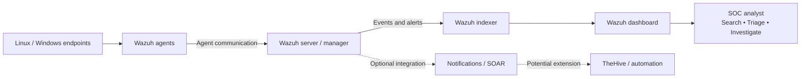

# Wazuh Home Lab — Security Monitoring & Detection

A hands-on home cybersecurity lab for learning endpoint monitoring, centralized log collection, alert analysis, and SOC investigation workflows with **Wazuh**.

> **Status note:** This repository documents the lab architecture and learning workflow. The homepage's animated data flow is a simulation, not live Wazuh telemetry. Features listed in the roadmap are planned or experimental unless explicitly documented as implemented.

## Contents

- [Project goals](#project-goals)
- [Architecture](#architecture)
- [Event data flow](#event-data-flow)
- [Components explained](#components-explained)
- [Repository structure](#repository-structure)
- [Deployment model](#deployment-model)
- [Run the documentation site](#run-the-documentation-site)
- [Endpoint onboarding](#endpoint-onboarding)
- [Validation checklist](#validation-checklist)
- [Security and privacy](#security-and-privacy)
- [Troubleshooting](#troubleshooting)
- [Roadmap](#roadmap)
- [References](#references)

## Project goals

This project provides practical experience with:

- Centralized endpoint log collection and security monitoring.
- Host-based intrusion detection and security configuration assessment.
- Reviewing alerts and investigating suspicious activity from a SOC analyst's perspective.
- Understanding how agents, the Wazuh manager, indexer, and dashboard work together.
- Documenting a reproducible lab and extending it safely with additional telemetry and response workflows.

This is a learning environment, not a claim of production-grade security monitoring. Only monitor systems and networks you own or are authorized to assess.

## Architecture



### How to read this architecture

1. **Endpoints** are the systems being monitored. They generate authentication, operating-system, application, and security events.
2. **Wazuh agents** run on endpoints, collect configured telemetry, and forward it to the Wazuh server.
3. **Wazuh server/manager** receives and analyzes events using decoders and rules. Matching rules can produce alerts. Depending on configuration and version, Wazuh also supports capabilities such as file integrity monitoring, security configuration assessment, and vulnerability detection.
4. **Wazuh indexer** stores and indexes data so it can be searched efficiently.
5. **Wazuh dashboard** is the analyst interface for searching data, reviewing alerts, and checking endpoint status.
6. **SOC analyst** validates alerts, gathers context, determines whether activity is suspicious, and chooses an appropriate response.
7. **Optional integrations** can notify an analyst or pass selected alerts to incident-management and automation tools. They are not assumed to be active in the base architecture.

The manager, indexer, and dashboard are separate logical components even when deployed together on one VM with Docker Compose.

## Event data flow

Example: a failed login occurs on a monitored Linux endpoint.

1. **Generate:** The operating system records the authentication event in a relevant log.
2. **Collect:** The Wazuh agent monitors configured sources and forwards events to the manager.
3. **Analyze:** The manager decodes the event and evaluates it against rules. If a rule matches, Wazuh can create an alert containing information such as timestamp, endpoint, rule ID, and severity.
4. **Index:** Data selected for storage is sent to the indexer.
5. **Display:** The dashboard queries indexed data and presents alerts and searchable events.
6. **Investigate:** The analyst reviews the event, surrounding activity, endpoint context, and whether the behavior is expected.
7. **Respond:** The analyst follows the lab's response procedure. Notifications or automated actions should be tested and tightly scoped before use.

**Important:** Not every collected event becomes an alert. Log collection settings, decoders, rule conditions, exclusions, and thresholds influence what appears in the dashboard.

## Components explained

| Component | Purpose | Key checks |
|---|---|---|
| Linux / Windows endpoint | Produces logs and endpoint telemetry | Logs exist; system time is correct |
| Wazuh agent | Collects configured data and communicates with the manager | Service running; agent enrolled and connected |
| Wazuh manager/server | Analyzes events and generates alerts | Services healthy; rules and decoders working |
| Wazuh indexer | Stores and indexes data | Service healthy; storage and connectivity available |
| Wazuh dashboard | Provides the analyst UI | Login works; data and alerts appear |
| Docker Compose | Runs services as separate containers | Containers healthy; volumes persist; secrets protected |
| Tailscale (optional) | Private connectivity between lab devices | Devices authorized; access limited to intended devices |
| GitHub Pages | Hosts this static documentation website | `main` branch and repository root selected |

Exact ports, service names, file paths, and settings vary by Wazuh version and deployment. Follow documentation for the version you install.

## Repository structure

```text
.
├── index.html                    # Homepage and simulated data-flow animation
├── assets/
│   ├── app.js                    # Website interactions and animation
│   ├── style.css                 # Site styling
│   └── favicon.svg               # Site icon
├── docs/
│   ├── architecture.html         # Components and connections
│   ├── data-flow.html            # Event lifecycle
│   ├── deployment.html           # Deployment notes
│   ├── endpoint-onboarding.html  # Agent onboarding
│   ├── validation.html           # Validation checks
│   ├── troubleshooting.html      # Diagnostic guidance
│   ├── privacy.html              # Privacy guidance
│   └── roadmap.html              # Planned extensions
├── README.md
├── SECURITY.md
├── .gitignore
└── .nojekyll
```

## Deployment model

The documented lab design has used this general layout:

- **Arch Linux host:** workstation used to manage and access the lab.
- **Ubuntu Server VM:** runs a Wazuh single-node deployment using Docker Compose.
- **Wazuh containers:** manager, indexer, and dashboard run as separate services.
- **Monitored endpoints:** Linux and Windows devices with Wazuh agents enrolled.
- **Private remote connectivity:** Tailscale has been used to connect devices without exposing Wazuh services directly to the public internet.

This is a description of the deployment approach, not a guarantee that every service is currently running. Inspect the current VM and container state before troubleshooting.

### Network security principle

Keep management interfaces and data services private. Do not expose the dashboard, indexer, or agent enrollment services directly to the public internet just to enable remote monitoring. Prefer a private VPN/overlay network, firewall allow-lists, strong authentication, and only the required connections between known devices.

## Run the documentation site

The site is static HTML, CSS, and JavaScript; it does not require a Node.js build step.

```bash
python -m http.server 8000
```

Run the command from the repository root, then open `http://localhost:8000`. Stop the server with `Ctrl+C`.

### Publish with GitHub Pages

In GitHub, open **Settings → Pages** and select:

- **Source:** Deploy from a branch
- **Branch:** `main`
- **Folder:** `/(root)`

Save and wait for deployment. The URL format is `https://<username>.github.io/<repository-name>/`.

## Inspect the Wazuh deployment

If the deployment uses Docker Compose, go to the directory containing the Compose file and inspect the current state:

```bash
docker compose ps
docker compose logs --tail=100
```

Use instructions that match your installed Wazuh version and Compose configuration. Do not blindly reuse old passwords or configuration from a previous deployment. Confirm required configuration, certificates, volumes, and secrets before starting services.

## Endpoint onboarding

The exact procedure depends on the operating system and Wazuh version. At a high level:

1. Install the Wazuh agent using the official instructions.
2. Configure the manager address using an appropriate private, reachable address.
3. Enroll/register the agent using the supported method.
4. Enable and start the agent service.
5. Confirm that the endpoint appears as connected.
6. Verify that expected logs arrive and that a known, harmless test event can be found.
7. Document endpoint role and custom collection settings in private lab notes.

Never publish enrollment passwords, API credentials, tokens, certificates, private IPs, or personally identifying endpoint details in this repository.

## Validation checklist

- [ ] Manager, indexer, and dashboard services are healthy.
- [ ] Dashboard is reachable from an authorized device.
- [ ] Agent is enrolled and connected.
- [ ] Endpoint and server clocks are synchronized.
- [ ] Expected endpoint logs are being collected.
- [ ] A known test event can be found in the dashboard.
- [ ] Relevant alerts show expected timestamps, endpoint details, and rule information.
- [ ] Dashboard and indexer are not unnecessarily exposed to the public internet.
- [ ] Persistent volumes are configured where needed.
- [ ] Backup and recovery steps have been considered.
- [ ] Secrets and private infrastructure details are excluded from public Git history.

## Security and privacy

- Monitor only systems and networks you own or have permission to monitor.
- Restrict Wazuh access with private networking, host firewalls, and network controls.
- Use strong, unique credentials and protect passwords, certificates, API keys, and enrollment secrets.
- Never commit secrets. If a secret was committed, rotate/revoke it; deleting it from the latest version is not sufficient.
- Avoid publishing public or private IPs, identifying hostnames, usernames, personal paths, or raw logs containing personal data.
- Keep Wazuh and the underlying operating system updated.
- Test active response and automation in isolation before enabling it on real endpoints.
- Treat alert severity as an investigation signal, not proof that an incident occurred.

See `SECURITY.md` and `docs/privacy.html` for additional guidance.

## Troubleshooting

| Symptom | First checks |
|---|---|
| Dashboard does not load | Dashboard service/container health, listening address, firewall, and network path |
| Dashboard loads but shows no data | Indexer health, data ingestion, selected time range, and dashboard data views |
| Agent is disconnected | Agent service, manager address, routing/VPN, firewall rules, enrollment status |
| Agent is connected but logs are missing | Source log, agent collection configuration, permissions, timestamps |
| No alert is generated | Confirm event reaches manager; inspect decoder/rule matching and expected alert behavior |
| Containers restart repeatedly | `docker compose ps`, logs, memory, disk space, certificates, and configuration |
| Remote access fails | Private-network device status and access controls; do not expose services publicly as a workaround |

See `docs/troubleshooting.html` for more context. Exact commands vary by deployment version.

## Roadmap

These are potential extensions and are **planned or experimental unless implementation is documented and tested**:

- **Notifications:** send selected alerts to a controlled channel such as Telegram.
- **SOAR and case management:** integrate TheHive for incident cases and response tracking.
- **Additional visualization:** evaluate Kibana or other tools only if they add value beyond the Wazuh dashboard.
- **AI-assisted triage:** summarize alert context and suggest investigation steps, with analyst review and no unverified autonomous response.
- **Threat intelligence:** evaluate MISP or curated feeds for enrichment.
- **Network telemetry:** consider Zeek or Suricata and document how their events are ingested and correlated.
- **Windows telemetry:** improve Windows event collection and evaluate Sysmon where appropriate.
- **Response automation:** create narrowly scoped, auditable playbooks with testing, approval controls, and rollback.
- **Operations:** add health checks, backup/restore tests, capacity monitoring, and recovery documentation.

Mark a roadmap item as implemented only after it is configured, tested, and documented.

## References

- [Wazuh documentation](https://documentation.wazuh.com/current/)
- [Wazuh quickstart](https://documentation.wazuh.com/current/quickstart.html)
- [Wazuh Docker deployment](https://documentation.wazuh.com/current/deployment-options/docker/index.html)
- [Wazuh agent enrollment](https://documentation.wazuh.com/current/user-manual/agent/agent-enrollment/index.html)
- [GitHub Pages documentation](https://docs.github.com/en/pages)
- [Tailscale documentation](https://tailscale.com/kb/)

---

**Learning objective:** understand how endpoint telemetry becomes searchable security evidence, how an analyst validates alerts, and how a small SOC lab can be expanded safely and incrementally.
